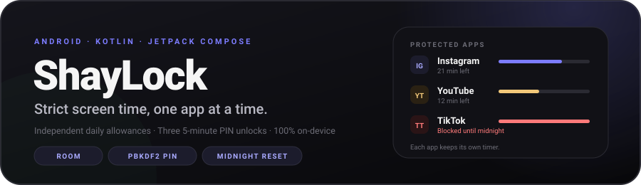

<p align="center">
  
</p>

<p align="center">
  
</p>

<h1 align="center">ShayLock</h1>

<p align="center">
  <strong>Your apps. Your allowance. Your PIN. No negotiation.</strong>
</p>

<p align="center">
  ShayLock gives every app you choose its own daily timer. When the time is gone, a full-screen
  lock covers that one app — no endless scroll, no soft warning you can swipe away. A PIN you
  control is the only way through, and it buys exactly five minutes.
</p>

<p align="center">
  
  
  
  
  
  
</p>

<p align="center">
  <a href="https://shaylock.vercel.app/"><strong>Website</strong></a> ·
  <a href="https://github.com/The-Infernix/ShayLock/releases/latest/download/ShayLock.apk"><strong>Download APK</strong></a> ·
  <a href="https://the-infernix.github.io/ShayLock/"><strong>Project page</strong></a>
</p>

---

<a id="table-of-contents"></a>
## 📑 Table of Contents

- [✨ Highlights](#highlights)
- [🎚️ The Blocking Model](#blocking-model)
- [🧭 Features](#features)
- [🔁 On-Device Data Flow](#data-flow)
- [🏗️ Architecture](#architecture)
- [🗂️ Project Structure](#project-structure)
- [🛠️ Tech Stack](#tech-stack)
- [🔐 Privacy & Permissions](#privacy-permissions)
- [🚀 Getting Started](#getting-started)
- [🧪 Build, Test & Quality](#build-test-quality)
- [🚧 Known Limitations & Roadmap](#known-limitations-roadmap)
- [🤝 Contributing](#contributing)
- [📄 License](#license)
- [🙏 Acknowledgements](#acknowledgements)

---

<a id="highlights"></a>
## ✨ Highlights

| | |
|---|---|
| 🎯 **Any app, not just Instagram** | Search every launchable app on the device and protect as many as you want. Nothing is hardcoded. |
| ⏱️ **Independent timers** | Each package owns its allowance, usage counter, override budget and limit-change cooldown — in its own Room row. |
| 🔒 **Strict lock screen** | A modal overlay covers the blocked app and swallows Home, Back and Recents. The timer pauses while the lock is visible. |
| 🔑 **Your own PIN** | A 4-digit PIN stored as a salted **PBKDF2-HMAC-SHA256** hash (120 000 iterations, 16-byte salt). The legacy `2310` only survives as an upgrade seed. |
| 🎟️ **Capped escapes** | Three five-minute unlocks **per app per day**. No shared global quota, no infinite extensions. |
| 📉 **One limit change a day** | The first allowance is free. After arming, changing an app's allowance needs the PIN and is limited to once per app per day. |
| 🌐 **Chrome web rule** | While an Instagram package is protected, `instagram.com` in Chrome is blocked too — and shares Instagram's override budget. |
| 🛡️ **Resilient by design** | Foreground overlay service, accessibility watchdog, persisted in-flight sessions, and a 15-minute WorkManager health check. |
| 🎨 **Dark, deliberate UI** | A custom Material 3 ink palette, per-app progress bars, live countdowns and a lock screen that looks like it means it. |
| 🔌 **Zero network** | No `INTERNET` permission, no analytics, no accounts, no servers. Everything stays on the device. |

---

<a id="blocking-model"></a>
## 🎚️ The Blocking Model

ShayLock is not a nudge engine. It has four states, and each app moves through them on its own.

| State | What it means | What you see | What you can do |
|---|---|---|---|
| `PROTECTED` | The app still has allowance left | Green progress bar, remaining time | Keep using it — foreground time is counted |
| `BLOCKED` | The app's allowance is used up | Full-screen lock over that app | Enter the PIN for a 5-minute unlock, or wait for midnight |
| `UNLOCKED` | A PIN override is running for one app | Amber chip and a live `MM:SS` countdown | Use the app; the lock returns automatically when the timer ends |
| `RESET` | Local midnight arrived | Usage and counters return to zero | The allowance itself is preserved |

**Rules that never bend**

| Action | Cost |
|---|---|
| Add an app / first allowance | Free |
| Change an allowance after arming | PIN + once per app per day |
| Remove a protected app | PIN (after arming) |
| Turn protection off | PIN |
| Unlock a blocked app | PIN + one of 3 daily overrides, 5 minutes each |

Every app's state is independent: using all three Instagram unlocks has no effect on TikTok's
budget, and exhausting YouTube does not lock Instagram.

> **Why a hard lock?** Because a dismissible reminder is easy to dismiss. ShayLock's lock screen is
> only escapable with the PIN, and the PIN only buys five minutes.

---

<a id="features"></a>
## 🧭 Features

### 🏠 Dashboard

Today at a glance: overall progress across every protected app, the current state of protection,
per-app cards with icons, usage bars, remaining time, unlock budget and status chips. Everything
is driven by `StateFlow`, so the dashboard updates while the accessibility service counts time.

### ➕ App picker

A searchable, multi-select list of installed launchable apps. Already-protected apps are filtered
out, package names are visible for disambiguation, and each selection is added with the default
30-minute allowance. The picker reads `PackageManager` off the main thread and resolves real
launcher icons asynchronously.

### ⏱️ Per-app timers

Each `TrackedApp` stores its own daily limit, committed usage, overrides used, active override
session and limit-change counter. A running foreground session is merged into the displayed usage
live; only committed time is written to disk, with checkpoints every five seconds.

### 🔒 Full-screen lock

The lock is a Compose `Dialog` hosted through `TYPE_APPLICATION_OVERLAY`, not a notification or a
floating card. It is non-cancellable, ignores the back key, and the accessibility service consumes
Home/Back/Recents while it is visible. If the foreground service cannot start, the overlay is
drawn directly from the accessibility service as a fallback.

### 🔑 PIN & security

- User-defined 4-digit PIN, verified against a salted PBKDF2 hash
- Constant-time hash comparison
- Change flow: verify current PIN → choose new PIN → confirm new PIN
- The public default `2310` cannot be chosen as a new PIN
- Removing apps, changing allowances and disabling protection all require authorization

### 🌐 Chrome web rule

The old permanent Chrome block is now an extension of the Instagram app's own policy. When an
Instagram package is protected, opening `instagram.com` in Chrome shows the lock screen, and a PIN
unlock consumes Instagram's five-minute override. This closes the most obvious bypass without
creating a second, separate set of rules.

### 🛡️ Reliability

`ShayLockApp` initializes state before any service or activity, schedules a unique 15-minute
`ServiceHealthWorker`, and the accessibility service restores the in-flight foreground session
after process death. The overlay service is kept alive while protection is armed.

### 🎨 Interface

Dark-only Material 3 with semantic tokens: violet for active protection, amber for temporary
unlocks, red for blocks, green for healthy state. Custom keypad, animated PIN dots, progress bars
and a lock screen that matches the dashboard.

---

<a id="data-flow"></a>
## 🔁 On-Device Data Flow

```
foreground window change
        │
        ▼
BlockerAccessibilityService ── onForegroundAppChanged(package)
        │
        ▼
BlockController ── per-app session timer (1 s tick, 5 s checkpoint)
        │
        ├──► Room: tracked_apps snapshot
        ├──► SharedPreferences: global switch, in-flight session
        └──► StateFlow: appStates · blockedPackages
                    │
                    ▼
        block decision ──► OverlayService / OverlayWindowHost
                    │
                    ▼
             Compose lock screen
```

**Persistence split**

| Store | What lives there | Why |
|---|---|---|
| Room `tracked_apps` | Allowance, usage, overrides, override session, limit-change count, sort order | One row per app keeps timers independent |
| `SharedPreferences` (`shaylock_blocker`) | Blocker switch, has-been-armed flag, foreground package, in-flight usage start | Must be readable before Room opens |
| `PinStore` (`shaylock_security`) | Salt, PBKDF2 hash, custom-PIN flag | PIN must never be stored in plaintext |
| Legacy 1.x prefs | Old single-app limit/usage/session | Read once by the migration and then ignored |

All per-day counters — usage, overrides, active override and limit-change cooldown — reset
together at local midnight. The configured allowances are never touched by the reset.

---

<a id="architecture"></a>
## 🏗️ Architecture

A single-process, service-backed design. One object (`BlockController`) is the source of truth so
the accessibility watchdog, the overlay and Compose never disagree.

```
┌─────────────────────────────────────────────────────────────────┐
│  UI            Jetpack Compose · Material 3 · Navigation        │
│                SetupScreen · AppPickerScreen · PinSettingsDialog│
│                OverlayScreen · AboutScreen                      │
└───────────────────────────┬─────────────────────────────────────┘
                            │ collectAsState / StateFlow
┌───────────────────────────▼─────────────────────────────────────┐
│  CORE          BlockController (in-process state engine)        │
│                TrackedApp · DailyLimit · BlockPolicy · PinHasher│
└───────────────┬──────────────────────────────┬──────────────────┘
                │                              │
┌───────────────▼──────────────┐  ┌────────────▼─────────────────┐
│  DATA                        │  │  SERVICES                    │
│  Room (tracked_apps)         │  │  BlockerAccessibilityService │
│  SharedPreferences           │  │  OverlayService              │
│  PinStore (PBKDF2)           │  │  OverlayWindowHost           │
└──────────────────────────────┘  │  ServiceHealthWorker         │
                                  └──────────────────────────────┘
```

**Components**

| Component | Role |
|---|---|
| `MainActivity` | Hosts the dashboard, app picker and About screen; owns dialogs and permission refreshes. |
| `BlockController` | Process-wide state engine: Room persistence, per-app timers, override/PIN APIs, midnight rollover, legacy migration. |
| `BlockerAccessibilityService` | Watches `TYPE_WINDOW_STATE_CHANGED`, charges foreground time, resolves Chrome web targets, raises/switches the overlay. |
| `OverlayService` | `specialUse` foreground service that hosts the lock window and keeps the process alive while protection is armed. |
| `OverlayWindowHost` | Owns the non-cancellable Compose dialog, full-screen window flags, lifecycle owner and target package. |
| `OverlayController` | Small facade used by the watchdog and the UI to show, keep alive or stop the overlay service. |
| `ServiceHealthWorker` | 15-minute WorkManager check that warns when protection is armed but accessibility is disabled. |
| `ShayLockApp` | Initializes `BlockController` and schedules the unique health check. |
| `PinStore` / `PinHasher` | Salted PBKDF2-HMAC-SHA256 storage and constant-time verification. |

**Why one controller instead of per-screen ViewModels?** The blocker must make a synchronous
block decision inside an accessibility callback. A single in-process engine avoids IPC, database
round-trips in the hot path, and stale UI. Compose observes derived `StateFlow`s; the watchdog
reads `shouldBlock()` directly.

---

<a id="project-structure"></a>
## 🗂️ Project Structure

```
ShayLock/
├── app/src/main/java/com/example/shaylock/
│   ├── core/
│   │   ├── BlockController.kt      # Multi-app state engine + persistence
│   │   ├── BlockPolicy.kt          # Hard limits: overrides, cooldowns, options
│   │   ├── TrackedApp.kt           # Domain model + UI snapshot
│   │   ├── DailyLimit.kt           # Allowance and midnight rollover
│   │   ├── PinHasher.kt            # PBKDF2 helpers (JVM-testable)
│   │   ├── PermissionUtils.kt      # Accessibility/overlay checks
│   │   └── TimeFormat.kt           # Duration and countdown formatting
│   ├── data/
│   │   ├── ShayLockDatabase.kt     # Room database
│   │   ├── TrackedAppDao.kt        # Snapshot read/replace
│   │   ├── TrackedAppEntity.kt     # Room row + mappers
│   │   └── PinStore.kt             # Salted PIN preferences
│   ├── service/
│   │   ├── BlockerAccessibilityService.kt
│   │   ├── OverlayService.kt
│   │   ├── OverlayWindowHost.kt
│   │   ├── OverlayController.kt
│   │   └── ServiceHealthWorker.kt
│   ├── ui/
│   │   ├── screens/                # Setup, AppPicker, Overlay, Pin dialogs, About
│   │   ├── components/             # AppIcon, keypad, PIN dots
│   │   ├── theme/                  # Ink palette, typography, shapes
│   │   └── PermissionUiState.kt
│   ├── util/                       # AppCatalog, AppLabels
│   ├── MainActivity.kt
│   └── ShayLockApp.kt
├── app/src/main/res/xml/           # Accessibility config, backup rules
├── app/src/test/                   # JVM unit tests
├── assets/                         # Artwork used by this README
├── docs/                           # GitHub Pages site
├── gradle/libs.versions.toml
└── README.md
```

**Stats:** 39 Kotlin files · ~6.4 k lines · `minSdk 26` · `targetSdk 35` · Java 11 bytecode.

---

<a id="tech-stack"></a>
## 🛠️ Tech Stack

<table>
<tr><td align="center"><b>UI</b></td><td>


</td><td align="center"><b>State & Data</b></td><td>


</td></tr>
<tr><td align="center"><b>Platform</b></td><td>


</td><td align="center"><b>Build</b></td><td>


</td></tr>
</table>

---

<a id="privacy-permissions"></a>
## 🔐 Privacy & Permissions

ShayLock is **local-first by construction**:

- No `INTERNET` permission in the manifest
- No analytics, crash reporting, accounts or servers
- Every timer, allowance and counter lives in Room or `SharedPreferences` on the device
- The PIN is never stored in plaintext — only a salted PBKDF2 hash
- Uninstalling the app or clearing its data removes every restriction and every record

| Permission / access | Why ShayLock needs it |
|---|---|
| **Accessibility Service** (`BIND_ACCESSIBILITY_SERVICE`) | Detect foreground window changes, count foreground time, read Chrome's URL bar, and swallow Home/Back/Recents while the lock is visible. Granted explicitly in Settings. |
| `SYSTEM_ALERT_WINDOW` | Draw the full-screen lock over a blocked app. Special access, granted from Settings. |
| `FOREGROUND_SERVICE` + `FOREGROUND_SERVICE_SPECIAL_USE` | Keep the overlay service alive and visible while protection is armed. |
| `POST_NOTIFICATIONS` | Ongoing status notification and protection-off health alerts (Android 13+). Optional. |
| Package visibility (`<queries>` launcher intent) | List installed launchable apps in the picker. Only launcher activities are queried. |

> ShayLock does **not** use `PACKAGE_USAGE_STATS`. Usage is derived from accessibility window
> events, which also lets it distinguish a truly foreground app from keyboards and system UI.

---

<a id="getting-started"></a>
## 🚀 Getting Started

### Prerequisites

| Tool | Version |
|---|---|
| Android Studio | Ladybug or newer (AGP 8.10) |
| JDK | 17 |
| Android SDK | Platform 35 |
| Gradle | 8.11.1 (via the bundled wrapper) |
| Device / emulator | Android 8.0 (API 26) or newer |

### Clone & run

```bash
git clone https://github.com/The-Infernix/ShayLock.git
cd ShayLock

# Point Gradle at your SDK (or let Android Studio do it)
# local.properties -> sdk.dir=/path/to/Android/sdk

./gradlew :app:assembleDebug     # build the debug APK
./gradlew :app:installDebug      # install on a connected device
```

On Windows:

```powershell
git clone https://github.com/The-Infernix/ShayLock.git
cd ShayLock
.\gradlew.bat :app:assembleDebug
.\gradlew.bat :app:installDebug
```

### First launch

1. **Grant the two required permissions** — Accessibility and "Display over other apps". The
   dashboard explains both with direct settings shortcuts.
2. **Add apps** — open the picker, search, and select any launchable apps.
3. **Set allowances** — new apps start at 30 minutes. Adjust them for free before arming.
4. **Start protection** — arming is free; the dashboard switches to `ACTIVE`.
5. **Replace the PIN** — the legacy default is `2310`. Open **App PIN → Change** and set your own.

> The accessibility service is a **special access** grant, so it cannot be requested with a
> runtime dialog. Find it at `Settings → Accessibility → ShayLock`.

---

<a id="build-test-quality"></a>
## 🧪 Build, Test & Quality

```bash
./gradlew :app:assembleDebug          # debug APK
./gradlew :app:installDebug           # install on a device
./gradlew :app:testDebugUnitTest      # JVM unit tests
./gradlew :app:lintDebug              # Android Lint
```

**Current test coverage**

| Suite | What it covers |
|---|---|
| `BlockPolicyTest` | Override cap, override duration, limit-change cap, allowance options, legacy Instagram recognition |
| `DailyLimitTest` | Midnight boundaries, clamping, rollover preserves the allowance |
| `TrackedAppTest` | Per-app override math, cooldown, same-day identity, next-day counter reset |
| `PinHasherTest` | PIN validation, hash/verify, salt uniqueness, Base64 round-trip |

The `ExampleUnitTest` and `ExampleInstrumentedTest` templates are still present. There are no
real instrumentation or Compose UI tests yet.

> `:app:testDebugUnitTest` passes on the current `main`. Always run it before opening a PR.

---

<a id="known-limitations-roadmap"></a>
## 🚧 Known Limitations & Roadmap

ShayLock is deliberately strict, but it is not magic. The honest gaps, in priority order:

| # | Limitation | Impact |
|---|---|---|
| 1 | Chrome detection relies on the URL bar being exposed as an accessibility node | Incognito tabs, custom browser UIs or browser updates can evade the web rule |
| 2 | Protection depends on the accessibility service staying enabled | Some OEM battery managers kill it; the health notification warns you, but blocking stops |
| 3 | Home/Back/Recents swallowing is not guaranteed with gesture navigation | A determined user may navigate around the lock on some devices |
| 4 | Usage is wall-clock based, not `elapsedRealtime` | Changing the system clock shifts the counter |
| 5 | Room is at schema v1 with `exportSchema = false` and no migrations | A future schema change has no upgrade path yet |
| 6 | Android auto backup uses the default rules | The database and PIN preferences can be included in cloud backups unless excluded |
| 7 | No instrumentation or Compose UI tests | Regressions in the dashboard/picker/lock flow are not caught automatically |
| 8 | Only accessibility is health-checked | Revoking overlay permission is not proactively reported |
| 9 | No schedules, quiet hours or per-app profiles | Every allowance is a simple daily cap |
| 10 | The Chrome web rule is Instagram-specific | Other social sites are not filtered |

### Next up

- [ ] Add exported Room schemas and real `Migration` objects
- [ ] Exclude `databases` and `shaylock_security` from cloud backup
- [ ] Add per-app uninstall cleanup for stale tracked rows
- [ ] Extend `ServiceHealthWorker` to check overlay permission
- [ ] Add Compose UI tests for the dashboard, picker and PIN flow
- [ ] Harden Chrome URL detection (fallback signals, more Chromium variants)
- [ ] Add optional per-app schedules / quiet hours
- [ ] Add a recovery flow for revoked accessibility access

---

<a id="contributing"></a>
## 🤝 Contributing

Contributions are welcome — issues, ideas and pull requests alike.

1. **Fork** the repository and branch off `main`.
2. Keep the existing shape: `ui` observes `core`, `core` owns state, `service` drives it.
3. Follow the conventions already in the file you are editing — package layout, Compose
   structure, naming, and the dark-only ink palette.
4. Run `./gradlew :app:testDebugUnitTest` and `:app:lintDebug` before opening a PR.
5. Write a clear PR description: what changed, why, and how you verified it.

```bash
git checkout -b feature/my-change
# ... work ...
git add -A
git commit -m "feat(picker): add category filter"
git push -u origin feature/my-change
```

Please do not add network permissions, analytics, ads or third-party tracking. Keeping ShayLock
completely on-device is a core product promise, not an accident.

---

<a id="license"></a>
## 📄 License

Released under the **MIT License** — see [`LICENSE`](LICENSE) for the full text.

```
MIT License

Copyright (c) 2026 Infernix
```

ShayLock is free to use, study, modify and redistribute. The copyright and permission notice must
travel with copies of the source.

---

<a id="acknowledgements"></a>
## 🙏 Acknowledgements

Built with the Android Jetpack libraries — Compose, Room, WorkManager, Navigation — and standing
on the shoulders of the open-source Android community. Thanks to everyone who files an issue,
tests a build, or suggests a sharper way to protect focus.
